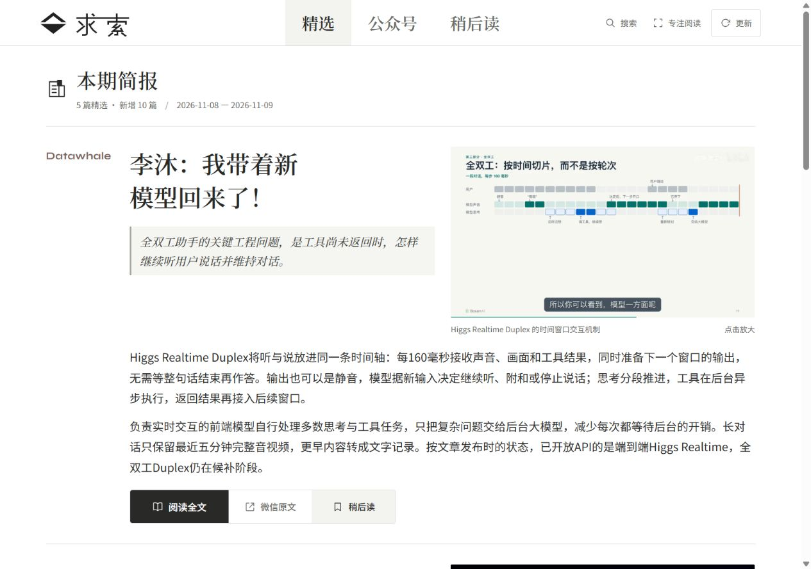

# QiuSuo Reading · 求索

面向大模型从业者的本地公众号阅读台，将精选简报、按公众号浏览和已归档原文放在同一个阅读空间。



## 阅读功能

- 首页直接展开精选简报；公众号分为工程实践与行业研究，简报不另设分类。
- 公众号目录与文章列表左右联动，文章区独立滚动，点击标题打开原文。
- 正文采用18px思源宋体，目录默认在左侧展开，可收起；支持阅读进度、字体、字号和行宽设置。
- 原文保留章节、代码、表格和真实图表；简报按内容需要配图，同号文章连续编排。
- 支持全库搜索、稍后读、图片放大和保存阅读位置。

## 本地运行

网页使用本地静态资源，运行只需Python 3，无需前端构建或安装Node依赖。

```powershell
git clone https://github.com/Lake-Evendim/QiuSuo-reading.git
cd QiuSuo-reading
python -m http.server 8807 --bind 127.0.0.1
```

打开 http://127.0.0.1:8807/prototype/#home 。Windows也可以在仓库根目录运行 `./预览.ps1`。

## 内容与采编

当前库保存17个关注来源、14篇文章；当前刊为2026年11月8—9日的5篇精选。2026年11月13日已采用按新规则重写的五篇简报，原始采集日期和文章全文保持，旧稿与修订记录独立归档。

网页展示已经保存的内容。更新由项目会话执行：发送“更新今日简报”或“补采某公众号”，助手读取采编规则，查找并核验原文、整理简报、完成检查后更新数据。网页的更新按钮提供可复制口令。

- [采编工作指南](采编工作指南.md)：来源核验、采集范围、分组编排和发布流程。
- [简报写作规范](简报写作规范.md)：重点前置、证据口径、阅读理由与编辑验收。
- [项目指令](AGENTS.md)：已采用的设计、用户偏好与维护要求。
- [本次简报修订](editions/20261108-09/revisions/20261113-briefs/)：旧稿、新稿、证据复核与正式验收。

## 目录

```text
prototype/           正式网页、文章数据、本地图片与字体
editions/            采集批次、来源证据与版本修订
font-sources/        字体原始文件及授权
brief-rewrite-lab/   五篇简报的新旧对照
*-lab/、channels-*/  设计与字体探索预览，采用状态见AGENTS.md
archives/            历史设计与维护记录
```

正式展示数据维护于 `prototype/data.js`；`edition.js/css` 维护简报，`channels.js/css` 维护公众号页面，`app.js` 负责原文阅读和通用交互。

## 字体维护

现有网页可以直接运行。新增文章或界面文字后，需要重建字体子集：

```powershell
python -m pip install fonttools brotli
python 字体更新.py
```

脚本优先读取Windows中已安装的Noto SC字体，其他环境使用 `font-sources/` 内的原始文件。独立预览有各自的字体脚本；维护入口见对应README。

第三方字体授权保存在 `font-sources/` 与各网页的 `assets/fonts/`；Pretext库的LICENSE及来源保存在 `prototype/vendor/pretext/`。文章出处、发布者与获取状态随归档数据保留。
