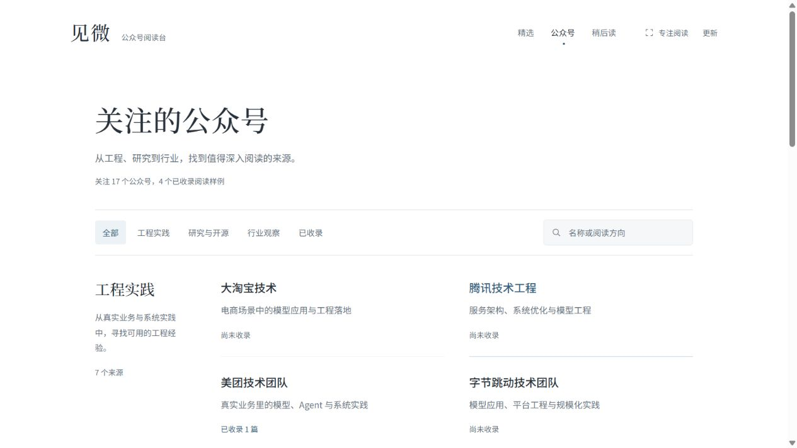
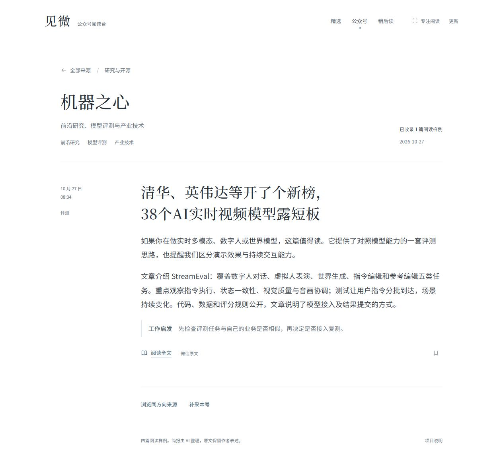
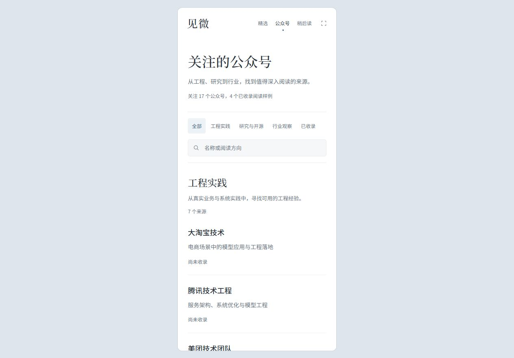

# 公众号界面评估与改造

2026-10-27。本轮改造公众号目录与单号阅读页，文章内容仍为四篇真实阅读样例。

## 评估与对应改动

| 原有问题 | 本轮改动 |
| --- | --- |
| 目录只有名称，无法判断阅读方向 | 每个来源增加见微整理的阅读方向；名称18px、介绍14px、状态12px |
| 三列布局长度不均，长名称与空白影响节奏 | 页边分类＋双列来源，按方向形成独立横向分组；窄屏使用单列 |
| 搜索仅匹配名称，零结果仍保留空分类 | 搜索支持名称、方向与英文别名；隐藏空分组，提供清除筛选入口 |
| “暂无文章”混淆未收录与未发布 | 用“尚未收录”或实际篇数，只描述本阅读库；未收录来源仍可进入 |
| 单号页重复账号名，阅读上下文不足 | 新增来源导航、阅读方向与实际收录范围；简报页边保留日期、时间和主题 |
| 单号全文的下一篇会跳到其他公众号 | 单号全文限定本号续读；末篇提供返回本号简报和其他来源入口 |

简报完整展开，不添加节选。白色底面、思源宋体标题／原文和思源黑体操作／简报保持一致，蓝色用于筛选与阅读操作。页面不使用假Logo、装饰序号或统一阴影卡片。

## 已完成的验证

- 目录共17个来源，分组数量为7／7／3；已收录筛选显示4个来源。
- `qwen` 匹配千问AI平台，`Agent` 匹配美团技术团队；零匹配时隐藏分类，清除后可恢复。
- 进入单号后返回目录，保留搜索与筛选；从长列表打开来源后，返回恢复原列表位置。
- 未收录来源展示阅读库状态、同方向入口及补采说明；口令正确显示为 `补采 量子位`。
- 美团单号的简报直接展开；全文末尾不出现其他来源的下一篇，提供返回本号入口。
- 桌面长名称“上海人工智能实验室”完整可见；390px外框窄屏目录与机器之心单号页改为单列，实际正文视口375px，页面无横向溢出。
- 本地字体子集重新生成，JavaScript语法检查通过。

当前每个已收录来源各有一篇样例；本轮实屏验证覆盖单号最后一篇的行为。多篇同号续读按日期排序实现，后续正式建库时再用实际多篇文章验证。

## 使用与内容范围

“补采本号”打开口令说明；复制后需发送到项目会话，网页没有自动启动采集任务。来源介绍是见微的编辑阅读方向，不是公众号官方简介。

当前内容仍为4篇样例，尚未建立正式最近7天文章库。机器之心、魔搭、美团的完整文字和35张原文配图已归档；硅基流动仅完整文字，配图仍通过微信原文查看。

新版截图：

