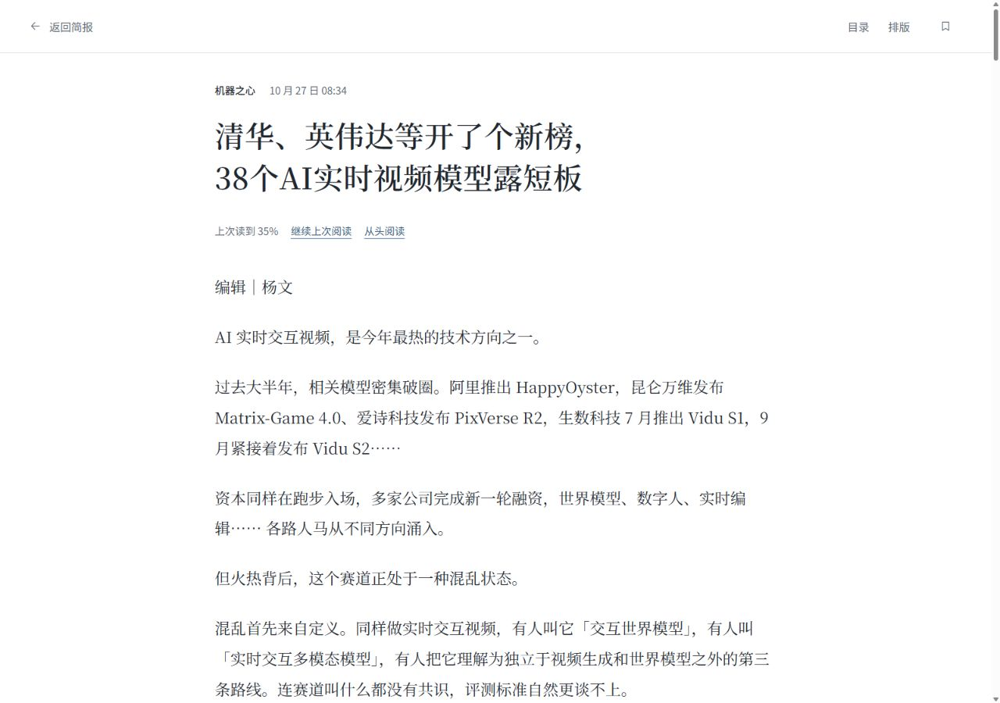
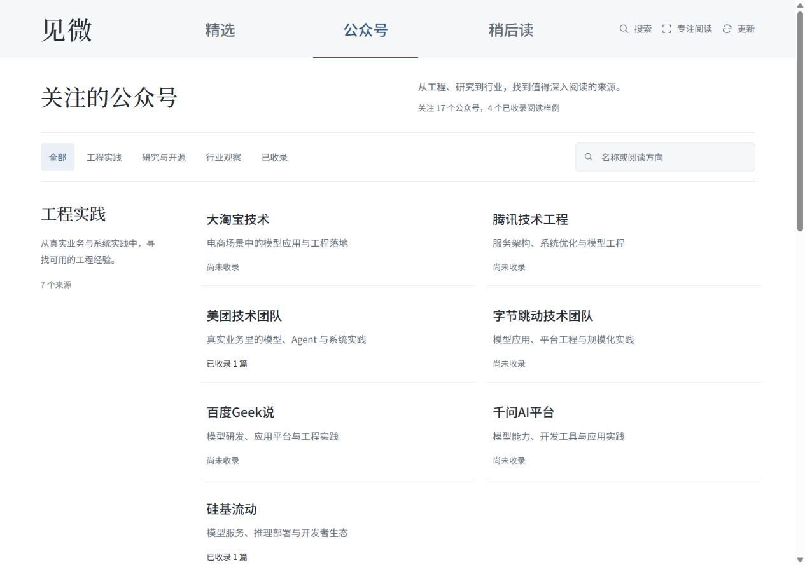

# 见微：设计评审与阅读改造

2026-10-28。评审基于首页、公众号目录、单号页和全文阅读的本机实屏。继续采用 B「视野期刊」。本轮只改展示和阅读体验，内容仍是4篇旧样例。

## 评审结论

原版已有清楚的期刊方向，但完成度中等。白底、冷浅灰、克制蓝色，以及宋体标题／原文、黑体简报／操作的分工，适合大模型从业者阅读技术材料。问题主要来自比例和阅读顺序：导航、页标题与文章标题轮流争夺注意力；标题左栏空洞，右栏文字密；全文入口被跨栏大图推到后面。辅助文字过细，颜色偏蓝且缺少统一角色。

功能基础较完整：能按公众号浏览，保存文章、搜索简报、控制全文排版并续读。原版的弱点是入口不够靠近当前阅读任务，部分字号与点击反馈较弱。内容尚未建立正式7天文章库，无法据此评估大量文章下的每日使用表现。

| 方面 | 问题 | 已完成改造 |
| --- | --- | --- |
| 美学与层级 | 页头过大，双栏高度悬殊，线条承担过多装饰 | 收紧页头；标题与阅读全文组成左栏，完整简报在右栏；真实重要图表随后跨栏展开 |
| 配色 | 灰色偏蓝，操作、章节和分隔混用强调色 | 正文采用中性墨色，辅助灰统一；蓝色用于选中状态、阅读操作与反馈，章节回归墨色 |
| 字体与节奏 | 标题行高过松，简报连续长段，辅助文字细小 | 标题38px/1.42，次标题34px/1.45；简报18px/1.9；辅助字号主要13–14px，窄屏12–13px |
| 全文体验 | 长标题与开篇动画占住首屏，正文进入太晚 | 720px舒适版心、20px宋体、1.95行高；减少标题区留白，开篇动画按需展开 |
| 目录体验 | 名称、方向、收录状态对比弱，卡片纵向空隙偏大 | 保留页边分组与双列结构，名称20px、介绍15px、状态13px；更清楚的对比和紧凑间距 |
| 操作与一致性 | 按钮细弱，单号页和收藏页阅读顺序不一致 | 全文按钮有明确蓝色填充；单栏页面依次呈现标题、简报、操作；保留关闭后的原位置 |

## 色彩与排版依据

| 角色 | 色值 | 在白底的对比度 |
| --- | --- | --- |
| 正文墨 | #222830 | 14.85:1 |
| 辅助灰 | #626b76 | 5.41:1 |
| 操作蓝 | #365a85 | 7.10:1 |
| 工作启发正文 | #505b68 | 6.91:1 |

阅读底面 #ffffff；工具底面 #f6f7f9；分隔 #dfe3e8。思源宋体承担刊名、标题和全文；思源黑体承担导航、简报和操作。实际 CSS 在本地字体加载后由 Pretext 测量标题。精选左栏在有限范围内调整，估算纳入标题下的操作高度；原文标题减少不必要的收窄。正文仍为原生连续 HTML，不进行逐行切片。

桌面保留24px主导航及92px点击高度，品牌、三入口和工具仍融合在同一条吸顶横幅。窄屏三入口持续可见，次要工具进入更多菜单。动效只响应切换、展开和收藏，保留系统与手动减少动效支持。

## 原文展示边界

逐张检查35张本地原图后，为6个图片块添加展示标注，其余文章字段完全保持原样：

- 机器之心的品牌条，以及美团的互动标题、活动奖品、品牌动图、社交平台条，共5张，标为公众号装饰图。B 默认收起，排版面板可选择“显示全部”，保存该偏好。
- 美团开篇循环示意动画保留在原文位置，用原生展开控件显示，默认收起；展开后可同页放大。它没有被删除或改写。
- 技术架构、论文、公式、评测榜单和示例配图继续直接显示。A/C 展示全部图片，不应用B的收起规则。

原文中的文字、代码、段落和图源均未变更。新的图文展示规则只用于阅读端。硅基流动样例仍注明完整文字、配图需查看微信原文。

## 验证结果

- 桌面1280px：4篇首页有完整简报和全文入口；首篇全文按钮在大图之前。全文舒适版心720px，20px默认字号；长标题、章节与图表正常。
- 390px、320px：三入口直接可见，首页和全文无横向溢出。最窄视口实测305px内容宽度；4篇全文均检查。390px目录17来源切换为单列。
- 搜索：Agent 匹配2篇文章和1个公众号；方向键选择、关闭、手机更多菜单及焦点回归正常。搜索范围为已归档简报和来源。
- 收藏：加入稍后读、数量反馈、单栏阅读与取消恢复正常。测试收藏已撤销。
- 目录：已收录显示4个来源；与Agent搜索组合后仅美团；返回目录保留条件；空结果能清除恢复。
- 原文：目录跳转、字号、字体、行宽、恢复默认、装饰图恢复、开篇动画展开、代码复制、专注和图表原始尺寸均检查。
- A/C：保留4篇简报与全文；A全部原图可见；C方向筛选及全文入口正常。
- Pretext：模拟加载失败回退原生排版；388字超长技术标识符在320px视口正常换行。
- 文件：本地JavaScript语法检查通过；23个HTML资源存在；35张归档图片通过本机HTTP读取；原始数据比较一致，仅新增6个展示标注；本地字体子集已重建。

以上是本机浏览器和现有样例的验证。尚未以大量文章、多天日刊或不同设备进行长期阅读评估。

## 本轮截图

